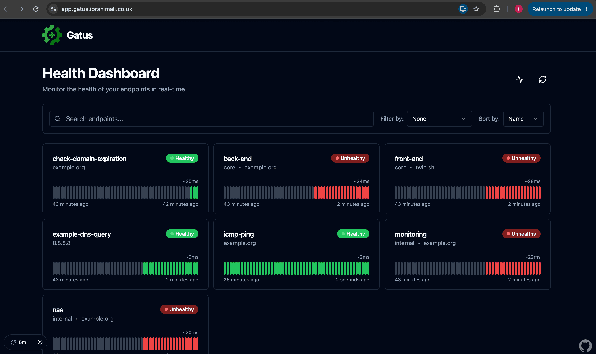
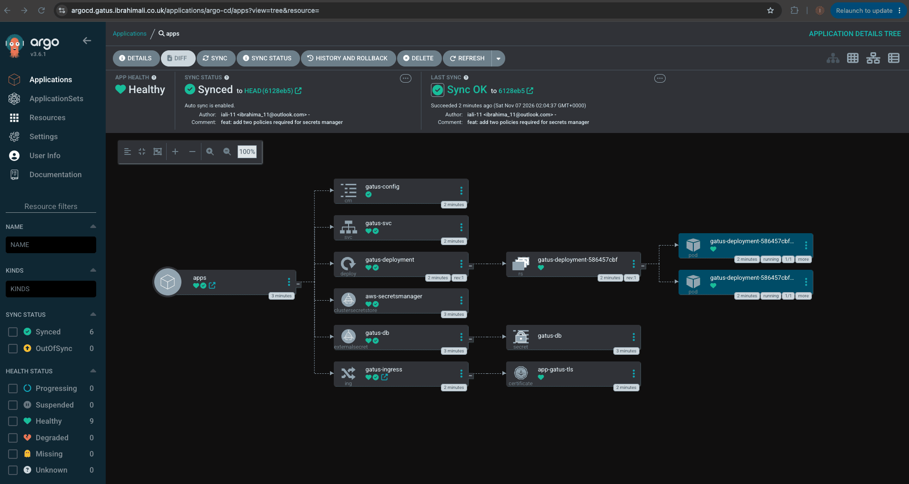
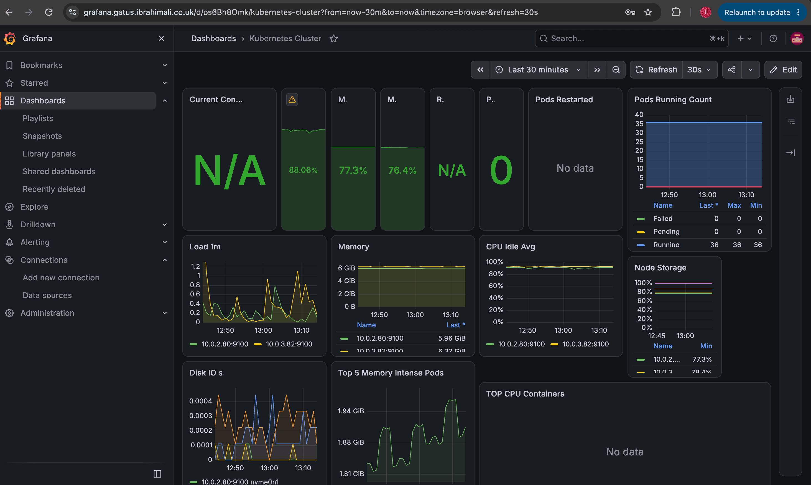
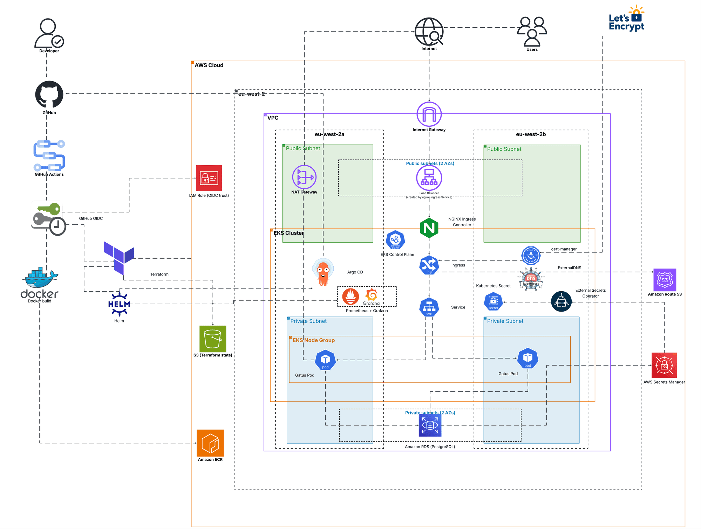
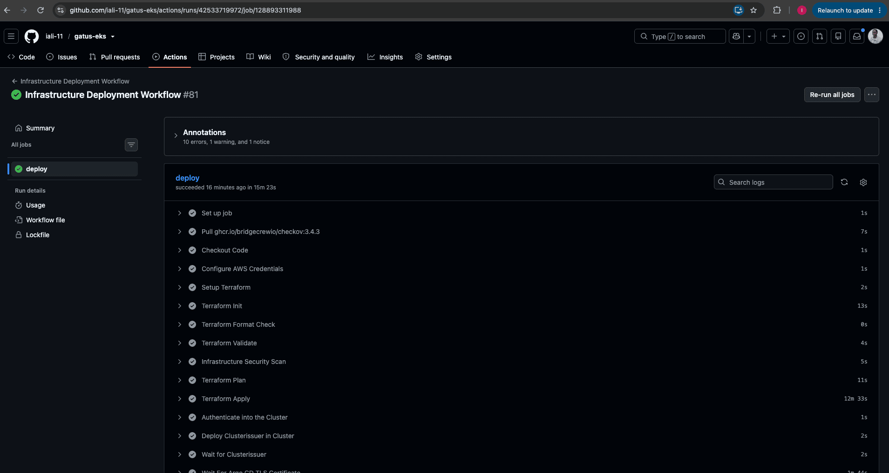
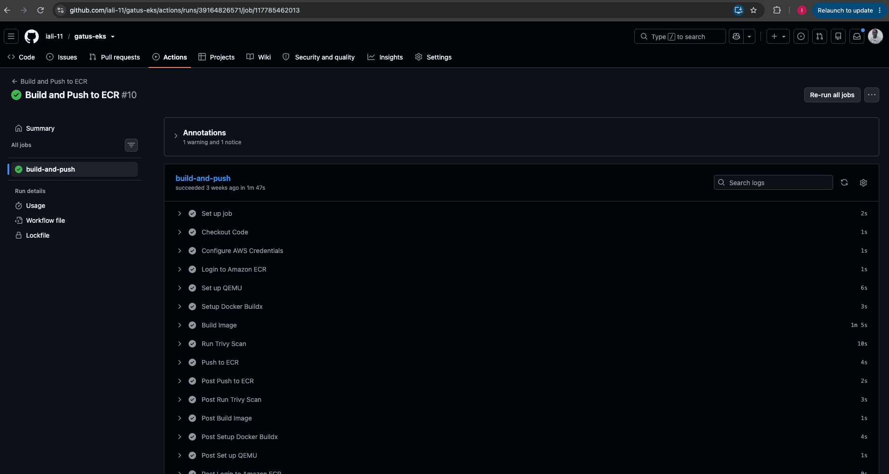
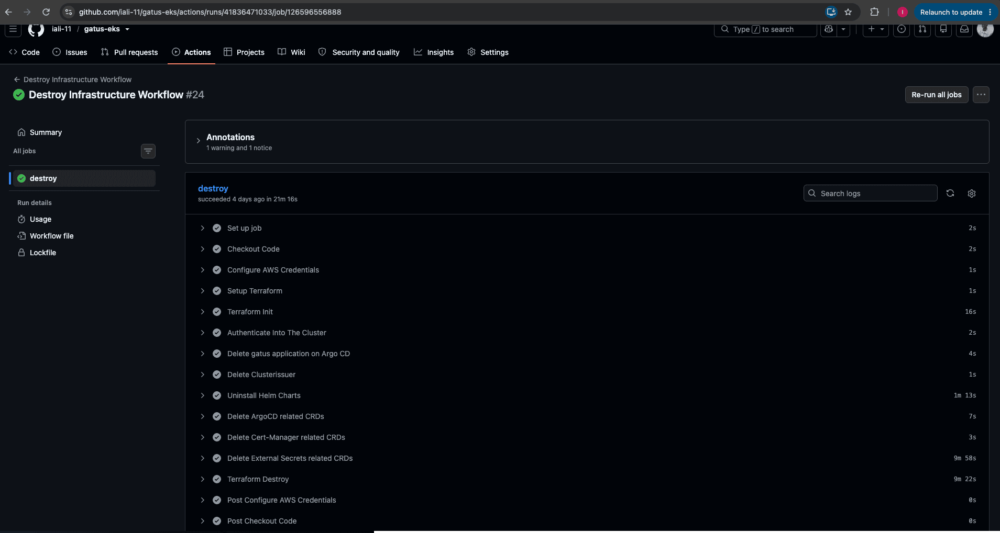
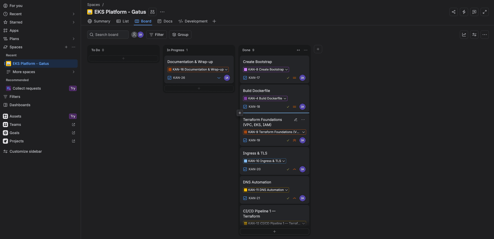

# Gatus on EKS - A Production-Style Kubernetes Platform on AWS


## Project Overview

This project deploys **Gatus**, an open-source uptime monitor, to **Amazon EKS** - along with the entire platform it needs to run: VPC, Cluster, IAM, Ingress, DNS, TLS, Database and monitoring, all built with Terraform.

Getting a container onto Kubernetes is the easy part. The goal was to practise everything around it: scoping permissions per workload, getting a database password into a pod without it ever being written down, deploying without touching the cluster, and rebuilding the whole thing identically after a teardown.


## Live Endpoints

| Service | URL | Live |
|---|---|---|
| Gatus | https://app.gatus.ibrahimali.co.uk/ |  |
| Argo CD | https://argocd.gatus.ibrahimali.co.uk/ |  |
| Grafana | https://grafana.gatus.ibrahimali.co.uk/ |  |

**I tear the cluster down between sessions so it isn't costing me money while I'm not working on it, so these are only live when the platform is up.**

## Local Setup

If you just want to see what Gatus does, deploy it locally with Docker:

```bash
cd app
docker build -t gatus:local .
docker run -d \
    -p 8080:8080 \
    -v $(pwd)/config.yaml:/app/config.yaml \
    gatus:local
```

Then open `http://localhost:8080`. It will start running the health checks defined in `config.yaml`.

### To deploy the full platform to AWS

```bash
# 1. Bootstrap - S3 state bucket, ECR repo, GitHub OIDC role
cd bootstrap
terraform init && terraform apply

# 2. The Platform
cd ../infra
terraform init && terraform apply

# 3. Wire the app to the database secret Terraform
terraform output db_address                               # -> gatus/deployment.yaml (DB_HOST)

# 4. Cluster access, then the application
aws eks update-kubeconfig --region eu-west-2 --name gatus-eks-cluster
kubectl apply -f ../cert-manager/issuer.yaml
kubectl apply -f ../argo-cd/gatus-argo.yaml
```

## Architecture Diagram



**The diagram shows the VPC boundary and both Availability Zones, the public subnets holding the AWS load balancer and NAT Gateway, the private subnets holding the EKS managed node group and the RDS instance, and the scope outside the VPC, including Route53, ECR, Secrets Manager and Let's Encrypt.**

## How a request reaches the app

1. `app.gatus.ibrahimali.co.uk` resolves via a Route53 record that **ExternalDNS** created from the Ingress object.
2. That record points at the AWS load balancer in front of the **NGINX Ingress Controller**.
3. NGINX terminates TLS with a Let's Encrypt certificate that **cert-manager** issued and keeps renewed.
4. The request goes to the `gatus-svc` ClusterIP Service, which spreads traffic across the two Gatus pods.
5. Those pods sit in private subnets in two AZs and read and write their state to a private **RDS PostgreSQL** instance.

## Project Structure
```
.
├── .github/
│   └── workflows/
│       ├── deploy.yaml              # Terraform + Checkov, then bootstraps the cluster
│       ├── docker-bulid-push.yaml   # Docker build, Trivy scan, push to ECR
│       └── destroy.yaml             # Manual teardown, in the right order
│
├── app/
│   ├── Dockerfile
│   ├── config.yaml
│   └── app source code                            # Gatus source and Dockerfile
│
├── bootstrap/                       # Run once - state bucket, ECR repo, OIDC role
│   └── modules
│       └── s3/  ecr/  oidc/
│
├── infra/                           # The platform, S3 remote state
│   ├── main.tf provider.tf variable.tf output.tf
│   └── modules/
│       ├── vpc/  sg/  iam/  eks/  rds/
│       └── helm/
│           └── values/              # argocd, cert-manager, external-dns, nginx, prometheus-stack
│
├── gatus/                           # Manifests synced by Argo CD
│   ├── cluster-secret-store.yaml
│   ├── configmap.yaml
│   ├── deployment.yaml
│   ├── external-secret.yaml
│   ├── ingress.yaml
│   └── service.yaml
│
├── argo-cd
│   └── gatus-argo.yaml          # Argo CD Application pointing at gatus/
│
├── cert-manager
│   └── issuer.yaml         # Let's Encrypt ClusterIssuer, DNS-01 via Route 53
│
├── .pre-commit-config.yaml
└── README.md
```

## The stack, layer by layer

### Application

- Gatus, a Go service with its web UI embedded in the binary
- Multi-stage Docker build ending on `scratch`, running as a non-root user
- Private ECR repository with scan-on-push
- Two replicas on separate nodes via `podAntiAffinity`

### Infrastructure

- Amazon EKS with a managed node group in private subnets
- VPC with two public and two private subnets across two Availability Zones
- Internet Gateway, and a single NAT Gateway for private egress
- Security groups for the cluster, the nodes and the database
- Amazon RDS for PostgreSQL - encrypted, private, gp3 with storage autoscaling
- Secrets Manager holding the database credentials, generated by Terraform and delivered to the cluster by External Secrets Operator
- Amazon ECR and Route 53
- IAM roles for the cluster, the nodes and individual workloads, via EKS Pod Identity
- S3 bucket for Terraform state, encrypted, with native state locking

### Kubernetes Platform

7 Helm releases, all declared as Terraform `helm_release` resources:

- Argo CD
- NGINX Ingress Controller
- Cert Manager
- External DNS
- External Secrets Operator
- Stakater Reloader
- kube-prometheus-stack

### Monitoring

- Prometheus, via `kube-prometheus-stack`, collecting metrics from the cluster, including pods, nodes, and services.
- Grafana, exposed at `grafana.gatus.ibrahimali.co.uk` behind its own Ingress, with a cert-manager certificate and an ExternalDNS record.
- Dashboards showing metrics from the cluster, including pod and node CPU and memory usage, pod health, node status, and ingress traffic

### Delivery
- Three GitHub Actions workflows: deployment, image build, teardown
- GitHub OIDC authentication to AWS, no stored keys
- Argo CD syncing the application manifests from this repo, with self-healing and pruning

### Security
- OIDC-based CI authentication, so no long-lived AWS credentials exist anywhere
- Per-workload IAM roles through Pod Identity, each scoped to one resource
- The database password is generated by Terraform, never typed by a human and never committed to Git - it lives in Secrets Manager and reaches the pod only through External Secrets, so no manifest or ConfigMap contains it.
- Every workload in a private subnet; the database not publicly accessible
- Checkov on the Terraform, Trivy on the image, ECR scan-on-push
- Non-root container on `scratch` - no shell, no package manager, nothing but the binary
- Encrypted Terraform state, encrypted RDS storage
- pre-commit hooks running gitleaks, private-key detection, `terraform fmt`, `validate` and `tflint` before anything reaches CI
- HTTPS on every hostname, issued and renewed automatically

## Pipelines

**Infrastructure Deployment**



**Docker Build and Push**



**Teardown**



## Agile Project Management

Work was planned and tracked in Jira. The project is broken into epics that map to delivery phases, each with its own tasks, so the build order was decided up front and progress was visible throughout:

- **Build Dockerfile** - multi-stage build, scratch runtime, non-root user
- **Create Bootstrap** - state bucket, ECR repository, GitHub OIDC role
- **Terraform Foundations** - VPC, EKS, IAM
- **Ingress & TLS** - NGINX Ingress Controller, cert-manager, Let's Encrypt
- **DNS Automation** - ExternalDNS and Route53
- **CI/CD Pipeline 1** - Terraform plan/apply with Checkov
- **CI/CD Pipeline 2** - App Build & Deploy with Trivy
- **GitOps with ArgoCD** - Deploys manifest files from Git repo structure, with auto-sync
- **Monitoring** - Prometheus & Grafana, collecting metrics and displaying through dashboards
- **Documentation & Wrap-up**

### Jira Board



## Learning Curves

- **Required anti-affinity deadlocks rollouts on a two-node cluster.** A deploy stalled with a pod `Pending` and `0/2 nodes are available: 2 node(s) didn't match pod anti-affinity rules`. With two replicas the default strategy works out to `maxSurge: 1, maxUnavailable: 0`, so Kubernetes tries to start a third pod before removing either old one, however strict anti-affinity forbids a third on a two-node cluster. Fixed with `maxSurge: 0, maxUnavailable: 1`, which removes a pod before replacing it. The rollout strategy assumes spare scheduling capacity,strict anti-affinity removes it.
- **RDS-managed secret ARNs change on every rebuild.** After a teardown the pods came up in `CreateContainerConfigError`, and External Secrets was logging `AccessDeniedException` on a secret ARN that did exist. The IAM policy allowed the new database's secret while the manifest still named the old one, which lingers in its recovery window. `manage_master_user_password` generates a fresh `rds!db-<uuid>` per instance, so that ARN can't be pinned in Git. I now create the secret myself as `gatus/db` with `recovery_window_in_days = 0` so the name is reusable immediately.